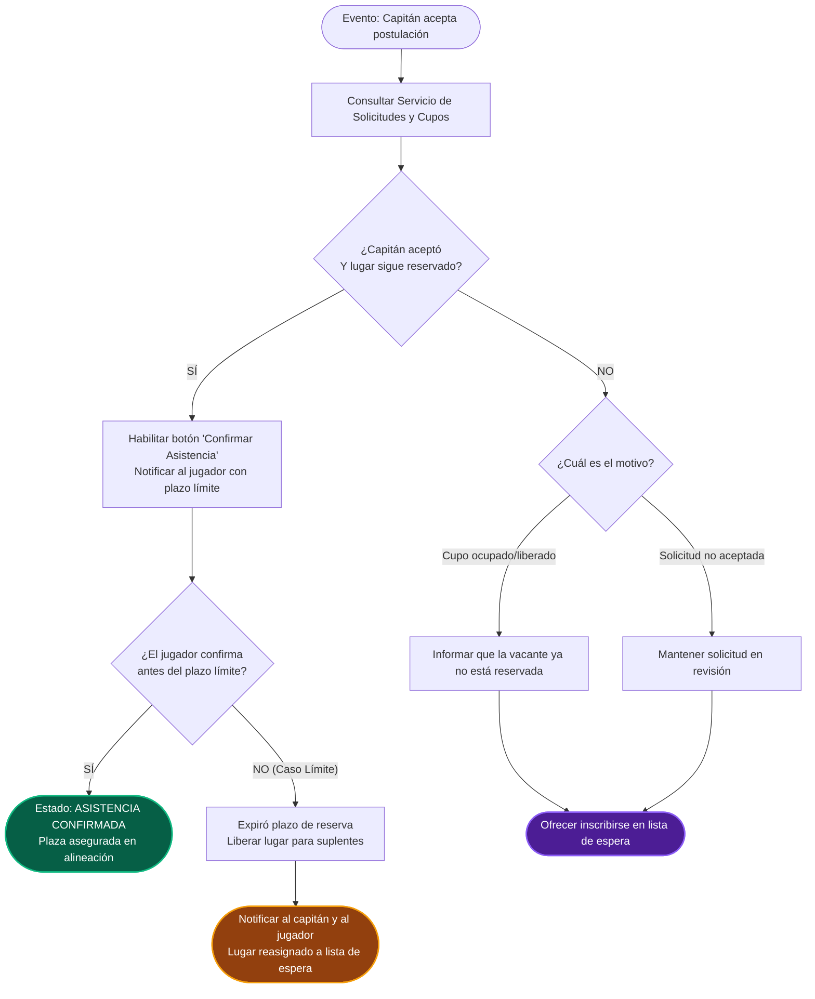
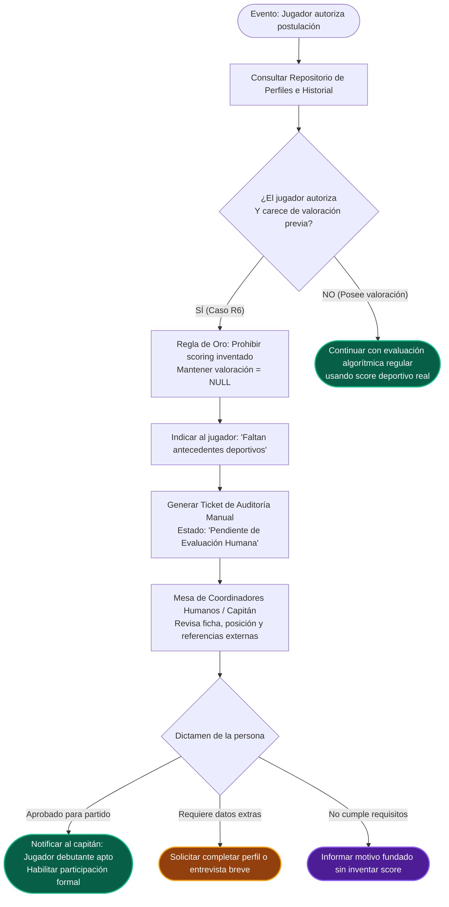

# Análisis y Planificación · TP3 Grupo 30 (Convocado)

**Grupo:** 30  
**Startup:** Convocado  
**Carrera:** Desarrollo de Sistemas Web Front End - IFTS 29  
**Cuatrimestre:** 2026 - 2do Cuatrimestre  
**Entrega:** 26/11/2026  
**Modalidad:** Grupal  
**Evaluación:** Sin nota numérica · Rúbrica oficial · Aprobado / Desaprobado (Nivel alcanzado: **Propone**)  

---

## 1. Identificación del caso y Asignación Oficial

De la asignación docente oficial por sorteo (Página 42 de la consigna del TP3):

| Campo | Valor Oficial |
|---|---|
| **Startup** | Convocado |
| **Rubro / Misión** | Deportes y conexión de equipos (Red para que jugadores encuentren equipos y soliciten participar en partidos). |
| **Bloque** | Asistencia y datos faltantes |
| **Sorteo / Ficha** | ASIGNACIÓN DOCENTE · SORTEO · S08-C |
| **Logo Oficial Asignado** | `S08.webp` (`Convocado.webp`, 360x360 px) provisto por el portal institucional |
| **Origen Institucional** | Lógica proposicional originada por estudiantes de **IFTS 16** · Solución Front End desarrollada por **IFTS 29** |

### Sentencias asignadas

**FRASE 1 · R5**
> *"Si el capitán aceptó al jugador y su lugar sigue reservado, el sistema permite que el jugador confirme su asistencia."*

**FRASE 2 · R6**
> *"Si un jugador sin valoración autoriza una solicitud, el sistema indica que faltan antecedentes y la deriva a evaluación manual sin asignarle una puntuación inventada."*

---

## 2. Análisis Lógico Formal

### 2.1 R5 - Confirmación de asistencia
* **Estructura lógica:** Conjunción estricta ($P \land Q \implies R$).
* **Condición 1 ($P$):** El capitán aceptó al jugador (la postulación pasó a estado formal *"Aceptada"*).
* **Condición 2 ($Q$):** Su lugar sigue reservado (la vacante no fue cedida, cancelada ni liberada).
* **Consecuencia obligatoria ($R$):** El sistema habilita la acción *"Confirmar asistencia"* para ese deportista.
* **Caso límite agregado por el grupo (Nivel Propone):** Si el jugador aceptado no confirma dentro de un plazo límite prudencial (ej. 3 horas antes del partido), el agente implementa un *timeout*, libera la reserva temporal y promueve al siguiente deportista en lista de espera para asegurar que el equipo no quede con un jugador menos.

### 2.2 R6 - Falta de valoración y derivación a evaluación manual
* **Estructura lógica:** Detección de condición + Restricción ética de no imputación + Derivación.
* **Condición 1 ($P$):** Jugador sin valoración deportiva (no tiene partidos jugados ni historial de puntaje: `rating === null`).
* **Condición 2 ($Q$):** Autoriza una solicitud para unirse a un partido.
* **Acciones obligatorias:**
  1. El sistema señala de forma transparente al usuario: *"Faltan antecedentes deportivos"*.
  2. Deriva el caso a una cola de evaluación manual por coordinadores o capitanes humanos.
  3. **Regla de oro ética:** Prohibición estricta de asignarle una puntuación inventada o calculada por promedios arbitrarios.
* **Caso límite agregado por el grupo (Nivel Propone):** Ante un partido inminente (menos de 2 horas), el agente activa el canal express notificando directamente al capitán para que decida una autorización extraordinaria como *"Jugador a prueba"*.

---

## 3. Planificación de los Flujos Agénticos

### 3.1 Flujo 1: "Booking Guard Agent · Custodia Dinámica de Cupos" (R5)

| Paso | Actor/Agente | Acción | Tipo |
|---|---|---|---|
| 1 | Agente de Eventos | Recibe el evento *"Solicitud aceptada por capitán"*. | Inicio |
| 2 | Herramienta: Solicitudes & Cupos | Comprueba la firma del capitán y el estado de la reserva física en la cancha. | Consulta de API |
| 3 | Agente de Reglas | Evalúa: `(capitan_acepto === true) && (lugar_reservado === true)`. | Decisión |
| 4a | Agente de Interfaz (SÍ) | Habilita botón *"Confirmar Asistencia"* y notifica al jugador con reloj de cuenta regresiva. | Acción afirmativa |
| 4b | Agente de Interfaz (NO) | No habilita confirmación. Explica motivo (cupo expirado o rechazo) y ofrece lista de espera. | Alternativa |
| 5 | Caso Límite (Timeout) | Si el tiempo límite vence sin confirmación del jugador, libera la plaza y notifica al capitán. | Excepción (Propone) |

### 3.2 Flujo 2: "FairPlay Onboarding · Auditoría Transparente sin Sesgo" (R6)

| Paso | Actor/Agente | Acción | Tipo |
|---|---|---|---|
| 1 | Agente de Postulaciones | Recibe evento *"Jugador autoriza solicitud"*. | Inicio |
| 2 | Herramienta: Perfiles & Historial | Inspecciona antecedentes y número de partidos evaluados. | Consulta de API |
| 3 | Agente de Reglas | Evalúa: `(rating === null) && (autorizacion === true)`. | Decisión |
| 4a | Agente Ético (SÍ) | Bloquea generación de puntaje artificial (`rating = NULL`). Notifica al jugador *"Faltan antecedentes"*. | Salvaguarda |
| 4b | Agente de Ticketing | Genera Ticket con estado *"Pendiente de evaluación manual"*. | Acción |
| 5 | **Intervención Humana** | Mesa de coordinadores/capitán humano revisa perfil y define si lo habilita o pide datos. | Humano en el bucle |
| 6 | Caso Límite (Urgencia) | Si faltan < 2 hs para el partido, eleva ticket prioritario para autorización directa del capitán. | Excepción (Propone) |

---

## 4. Representación Gráfica (Mermaid.js)

Se implementaron diagramas de flujo completos que reflejan no solo la condición básica sino también las herramientas consultadas, los casos límite y la intervención de personas:

### Diagrama Flujo 1 (R5)

### Diagrama Flujo 2 (R6)

---

## 5. Estructura de la Landing Page Final

| Sección | Componentes y Contenido |
|---|---|
| **Hero / Presentación** | **Logo oficial de Convocado** (`S08.webp` / `convocado-logo.webp`), título, servicio, mención explícita del origen conjunto (IFTS 16 + IFTS 29), insignias del Grupo 30 y metadatos de entrega. |
| **Navegación** | Barra fija superior accesible por teclado con anclas a las 5 secciones principales. |
| **01 · Contexto y Desarme** | Misión de la startup, desafío 100% agéntico, y fichas formales de lógica proposicional (Datos necesarios $\to$ Condición $\to$ Consecuencia). |
| **02 · Flujo 1 (R5)** | Título y beneficio en 2 frases, diagrama gráfico Mermaid, y **desplegables interactivos `
`** (Datos, Lógica, Acciones, y Caso Límite por Timeout). |
| **03 · Flujo 2 (R6)** | Título y beneficio en 2 frases, diagrama gráfico Mermaid con salvaguarda ética, y **desplegables interactivos `
`** (Datos, Principio de Transparencia, Intervención Humana, y Partido de Urgencia). |
| **04 · Banco de Pruebas** | **Simulador Interactivo de Casos** con selectores para probar en vivo casos exitosos, negativos y casos límite (cumpliendo el paso 7 de la consigna). |
| **05 · Conclusión y Enfoque** | Reflexión agéntica, articulación del rol humano en la dirección y del agente en la generación de código. |
| **Footer** | Marcas, créditos académicos institucionales, rúbrica y datos del grupo. |

---

## 6. Registro de Deuda Técnica y Estado de Resolución

En la revisión crítica contra la consigna y la rúbrica oficial, se identificaron y subsanaron los siguientes puntos:

| Aspecto | Estado Inicial | Acción Correctiva Implementada | Estado Final |
|---|---|---|---|
| **Logo de la Startup (Rúbrica 03)** | Faltaba en la landing | Se descargó e integró el logo oficial `S08.webp` (`Convocado.webp`) con contenedor estilizado | ✅ Resuelto |
| **Desplegables Interactivos (Rúbrica 03)** | Todo estaba en texto estático | Se implementaron componentes semánticos `
` y `
` con estilo glassmorphism y foco accesible | ✅ Resuelto |
| **Crédito IFTS 16 (Pág. 6 Consigna)** | Omitido | Se incorporó una tarjeta de articulación académica destacando el origen de las reglas en el IFTS 16 | ✅ Resuelto |
| **README.md (Rúbricas 01, 02, 05)** | Inexistente | Se redactó el archivo `README.md` completo con integrantes, aportes, revisión entre pares, enlaces públicos y registro de IA | ✅ Resuelto |
| **Casos Límite e Intervención Humana (Rúbrica 04 · Propone)** | Incompletos / lineales | Se modeló la expiración por temporizador en R5 y el circuito de moderación humana con canal express en R6 | ✅ Resuelto |
| **Banco de Pruebas (Paso 7 Consigna)** | Solo teórico | Se desarrolló un simulador interactivo en JavaScript vanilla con botones para alternar y visualizar casos en tiempo real | ✅ Resuelto |

---

## 7. Conclusión y Dictamen Final

La solución propuesta para el **Grupo 30 (Convocado)** se encuentra **100% alineada con las directivas del TP3**:
1. Respetó el paradigma **100% agéntico**: el equipo humano analizó la consigna, definió la arquitectura y auditó el resultado; el agente de programación generó y corrigió el código sin edición manual de archivos.
2. Cumple con todos los requisitos de contenido, estructura y funcionamiento exigidos en desktop.
3. Incorpora elementos de valor agregado (simulador interactivo, casos límite y circuito humano de contingencia) orientados a calificar en el nivel superior **"Propone"** de la rúbrica docente.
